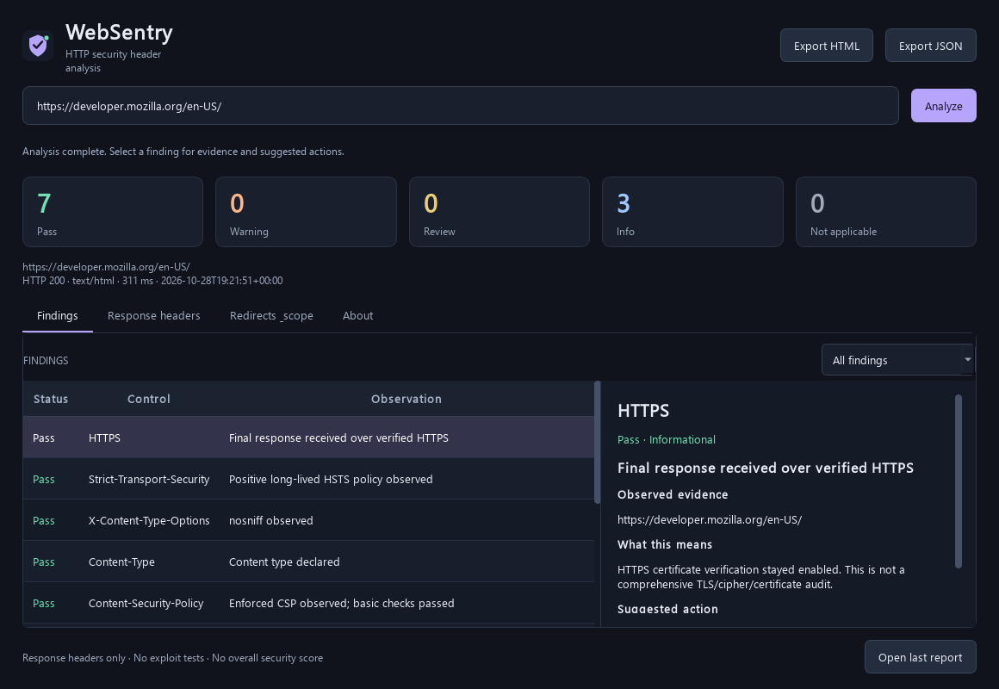

# WebSentry

WebSentry checks a website's HTTP response headers for common security configuration issues. It shows the observed values, explains each finding, and exports the results as HTML or JSON.



## Features

- Inspect a URL and record its redirect chain.
- Check HTTPS, HSTS, CSP, framing restrictions, and other response headers.
- Filter findings by status and view recommendations with technical references.
- Export an HTML report for reading and printing, or JSON for further processing.
- Run through the desktop interface or command line.

## Getting started

Requires Python 3.10 or later. Run these commands on Windows:

```powershell
git clone https://github.com/bayazitm/WebSentry.git
cd WebSentry
python -m venv .venv
.\.venv\Scripts\python.exe -m pip install -r requirements.txt
.\.venv\Scripts\python.exe main.py
```

Enter a URL and click **Analyze**. If the address has no scheme, WebSentry tries HTTPS. Select a finding to see its evidence, explanation, and recommended action.

For a packaged Windows build, extract the entire application folder and open `WebSentry.exe`. Keep the `_internal` folder beside the executable. A separate Python installation is not needed for that build.

## Checks

| Control | What is checked |
| --- | --- |
| HTTPS | Final connection security and HTTPS-to-HTTP redirect downgrades |
| Strict-Transport-Security | Applicability, duplicate or malformed directives, `max-age`, and disabled policies |
| X-Content-Type-Options | Presence of a single `nosniff` value |
| Content-Type | Presence and format of the declared media type |
| Content-Security-Policy | Enforced versus report-only policies and selected script/object source restrictions |
| Framing restrictions | CSP `frame-ancestors` and fallback to `X-Frame-Options` |
| Referrer-Policy | Recognized policy values and fallback ordering |
| Permissions-Policy | Presence of a feature-permissions policy for deployment review |
| Server information | Common technology and version-disclosure headers |
| X-XSS-Protection | Use of the deprecated browser XSS filter |

The HSTS lifetime check uses 180 days as a review threshold, not a protocol requirement. CSP and Permissions-Policy checks do not replace a full policy review.

## Reading the results

| Status | Meaning |
| --- | --- |
| Pass | The check found its expected condition. |
| Warning | A missing or potentially risky configuration was observed. |
| Review | The result needs further interpretation or application context. |
| Info | Background information or an optional hardening observation. |
| Not applicable | The check does not apply to this response. |

These are configuration findings, not confirmed vulnerabilities. The summary counts are not an overall security score.

## Reports

Use **Export HTML** or **Export JSON** after a completed analysis. HTML reports can be opened offline in a browser and printed to PDF. A [sample report](docs/example-report.html) is included using synthetic data.

Reports include the requested and final URLs, scan time, HTTP status, redirect chain, response headers, and findings. URL query values and selected sensitive headers are redacted; URL paths remain visible.

## Command line

Print a JSON report:

```powershell
.\.venv\Scripts\python.exe main.py --cli https://example.com
```

Save an HTML report:

```powershell
.\.venv\Scripts\python.exe main.py --cli https://example.com --format html --output report.html
```

Use the Python entry point for terminal output. The packaged Windows executable launches without a console.

## Scope

WebSentry evaluates the final HTTP response headers. It records intermediate redirects but does not separately assess their headers. It does not crawl the site, execute JavaScript, inspect HTML meta policies, or test exploits.

Missing headers do not prove that a site is exploitable, and passing the checks does not establish that a site is secure or trustworthy. Browser state, HSTS preload lists, parent-domain policies, and other resources can affect actual behavior. Error or challenge responses are identified in the report and may differ from the site's normal pages.

Certificate verification remains enabled. Browser sessions, stored credentials, and system proxy settings are not imported. Scans run locally, and reports are saved only when exported. Cancellation waits for any in-progress network operation to finish or time out.

## Tests

```powershell
.\.venv\Scripts\python.exe test_checks.py
```

Tests cover header rules, redirect handling, non-HTML responses, cancellation, redaction, and report escaping. Network-related tests use a local HTTP server.

## Windows build

```powershell
powershell -ExecutionPolicy Bypass -File .\build_windows.ps1
```

The application is created in `dist/WebSentry`. Distribute the whole folder, including `_internal`. See [THIRD_PARTY.md](THIRD_PARTY.md) for dependency information.

## References

- [OWASP Secure Headers Project](https://secure-headers-project.owasp.org/response-headers/)
- [MDN HTTP headers](https://developer.mozilla.org/en-US/docs/Web/HTTP/Reference/Headers)
